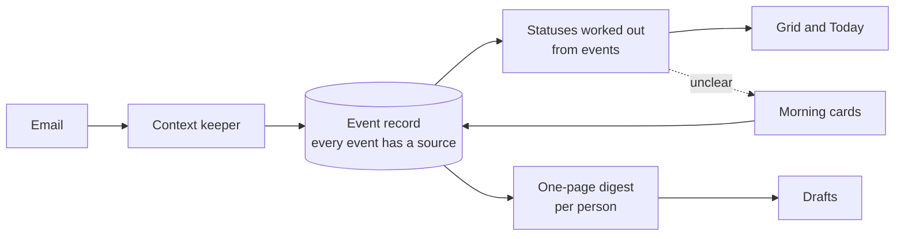

# Mise

**A one-person operating system for running two businesses solo.** Mise puts every lead, customer and supplier for Flywheel by GK and Kāma Coffee in one grid. Every cell shows where the fact came from and how old it is, and drafts are written from what actually happened instead of what someone last typed.

The source code is private because it runs on my live business data. This page covers what it does, how it works and the decisions behind it.

▶ [Watch the demo on Loom](https://www.loom.com/share/e3558290ddee467c9e2ee1bb72354acf) (4 minutes)

## The problem

I run a course business and a speciality coffee brand on my own. The work had spread across 23 Claude pages, several scheduled routines and two mailboxes. Statuses were typed once and never updated, so the same event was recorded in different places and those records disagreed. The morning briefing kept bringing back tasks I had already finished, and drafts took five to ten rounds because they did not know what each person had already been told.

A faster sync would only have copied the wrong answers more quickly, so I rebuilt how the data stays true.

## What it does

| Part | What you see |
|---|---|
| Grid | One table of people and companies across both businesses, with saved views. Each cell carries its source and its age. |
| Record panel | One panel per row: the timeline of what happened, reminders, and a draft reply that reads the whole thread first. |
| Today | What needs doing across both businesses, with anything done or decided already removed. |
| Cards | At most five yes-or-no questions a morning, only about things no system can see, such as a phone call. The same card never comes back twice. |
| Books | Live, read-only figures from the accounting system. Nothing is posted without my approval. |

## What it does in the background

Most of the value is in the jobs that run while I am doing something else.

| Job | What it does |
|---|---|
| Mail sweep | Reads every working folder in Zoho Mail since the last run, ties each message to the right person or company, and adds it to their timeline. It only reads, so nothing is moved or sent without me. |
| Lead updates | Moves a lead to its next stage when an email proves it, and turns anything unclear into a morning card. |
| Stale-fact clean-up | Marks any fact past its shelf life as unknown, and drops finished or decided items from the morning briefing. |
| Digest rebuild | Rewrites a one-page summary for everyone with new activity, so drafts start from the current picture. |
| Books reconciliation | Matches every bank statement line against Zoho Books and flags any payment that is missing from the books. |
| Statement filing | Merges each new statement upload into one file per bank account, so repeated uploads never pile up as duplicates. |
| Sync | Sends my laptop changes up to claude.ai on a schedule, and never overwrites a newer change with an older one. |

## How it stays current

1. **Record events, not conclusions.** Each thing that happens is stored once, with its source.
2. **Work statuses out from events.** Clear evidence moves a lead on its own; anything unclear becomes a card.
3. **Give every fact a shelf life.** Past it, the fact shows as unknown and never as current.
4. **Keep context small on purpose.** A keeper rebuilds a one-page digest for each person, so old facts drop out and drafts read the digest instead of chat memory.
5. **Let code, not the model, match mail.** Messages are matched to people by address in code, so the model cannot invent or misremember one.

## Built with

Node.js with no framework and a plain JavaScript front end. Claude Code runs on my existing Claude plan, with no separate API key. Mail and accounting data come through Zoho connectors, and claude.ai holds the data so the morning briefing reaches my phone with the laptop closed. The test suite uses Node's built-in test runner.

## How I built it

I wrote the spec before any code: the goal, who it is for, where every piece lived, and the measure of done. Claude Code built from that spec, and each design decision is logged with what was measured and why. It is the same spec engineering method I teach in the [Product Builder Certification by GK](https://maven.com/level-up-with-ai/product-builder-certification-spec-driven-ai-agents?utm_source=github&utm_medium=repo&utm_campaign=pbc-dec26&utm_content=gh-mise-showcase).

## Status

In daily use by one person, me. It is built for one operator, so sharing it would need a fresh look at the design.

Want a walkthrough of the code or the spec? [Book a call](https://calendly.com/flywheelbygk-info/1-on-1-gk) or email info@flywheelbygk.com.
